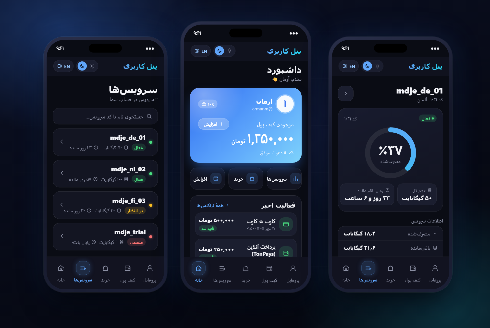
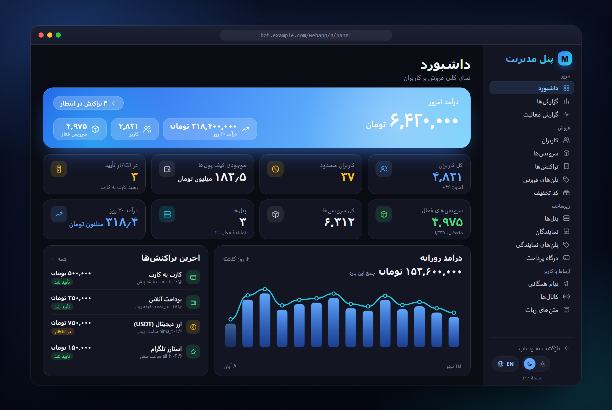

# MdjeBot

[](https://www.python.org/)
[](LICENSE)
[](https://github.com/LonamiWebs/Telethon)
[](https://mdjes.github.io/mdjeBot/)

**ربات‌ساز** تلگرام برای ساخت ربات فروش وی‌پی‌ان روی پنل [پاسارگارد](https://github.com/PasarGuard/panel)، توسعه و نگهداری توسط **Mdje**.

شما تعرفهٔ ماهانه را تعیین می‌کنید؛ مشتری تعرفه را می‌خرد، در @BotFather یک ربات می‌سازد و **توکنش** را برای ربات‌ساز می‌فرستد؛ ربات‌ساز همین سورس را با آن توکن به یک **ربات فروش مستقل** برای او تبدیل و اجرا می‌کند (کانتینر، دیتابیس و Redis جدا).

**[مستندات کامل (فارسی)](https://mdjes.github.io/mdjeBot/)**

## نصب سریع (لینوکس)

```bash
bash <(curl -fsSL https://raw.githubusercontent.com/mdjes/MdjeBot/main/scripts/mdjebot.sh)
```

اسکریپت فقط **توکن ربات‌ساز** (یک ربات جدید از @BotFather) و **آیدی عددی ادمین** را می‌پرسد و بقیه را خودکار انجام می‌دهد. بعد از نصب: `mdjebot`

## دو بخش پروژه

| | 🏭 ربات‌ساز (Builder) | 🤖 ربات (Bot) |
|---|---|---|
| چیست؟ | رباتی که **شما** مدیریت می‌کنید و مشتری‌ها با آن ربات و پنل می‌سازند | ربات فروش وی‌پی‌ان که برای هر مشتری ساخته می‌شود |
| کد | [`builder/`](builder/) | [`app/`](app/)، [`frontend/`](frontend/) |
| مستندات | [ربات‌ساز](https://mdjes.github.io/mdjeBot/docs/builder) | [راهنمای کاربر و ادمین](https://mdjes.github.io/mdjeBot/docs/admin) |

### 🏭 ربات‌ساز (Builder)

| بخش | امکانات |
|------|---------|
| کاربر | انتخاب تعرفه ← پرداخت (کیف پول / کارت‌به‌کارت) ← ارسال توکن ← ساخت خودکار ربات؛ تست رایگان، تمدید، تغییر ادمین |
| **🧩 فروش پنل** | اتصال به پنل پاسارگارد شما؛ مشتری پنل (ادمین با حجم و مدت مشخص) می‌خرد، ادمین **خودکار** روی پنل ساخته و ربات او به آن **وصل می‌شود**؛ تمدید، حجم اضافه، هشدار مصرف و قطع خودکار با اتمام حجم |
| ادمین (داخل تلگرام) | تعرفه‌ها، پرداخت‌ها و رسیدها، ربات‌ها، پنل‌ها، کاربران، کارت‌ها، کد تخفیف، تنظیمات، ارسال همگانی، به‌روزرسانی همهٔ ربات‌ها |
| اشتراک | ماهانه؛ یادآوری تمدید، توقف خودکار در پایان و حذف پس از مهلت |
| امنیت | توکن‌ها و رمزها رمزنگاری‌شده، پیام حاوی توکن پاک می‌شود، هر ربات کانتینر و دیتابیس جدا دارد |

راهنما: [ربات‌ساز](https://mdjes.github.io/mdjeBot/docs/builder) و [فروش پنل](https://mdjes.github.io/mdjeBot/docs/builder/panels).

### 🤖 ربات (Bot)

ربات فروش وی‌پی‌ان روی پنل پاسارگارد: خرید و تحویل آنی، تمدید، کیف پول، پرداخت (کارت‌به‌کارت، ارز دیجیتال، استارز، درگاه)، تست، نمایندگی، کد تخفیف، وب‌اپ و پنل تحت وب.

- **طراحی تازه:** پیام‌ها و منوها با یک طراحی یکدست (عنوان، جداکننده، یک ایموجی برای هر فیلد، راهنمای 💡) بازنویسی شده‌اند.
- **منوی ادمین شیشه‌ای:** دکمه‌های پنل مدیریت و دکمه‌های داخل پیام‌های آن زیر پیام نمایش داده می‌شوند؛ نام، رنگ و **ایموجی متحرک** هر دکمهٔ منو از «⌨️ مدیریت دکمه‌های کیبورد» قابل تغییر است. قاب «「 」» همهٔ دکمه‌های ادمین از صفحهٔ ۶ همین بخش روشن و خاموش می‌شود.
- **منوی کاربران قابل تنظیم است:** در ربات‌های جدید منوی اصلی کاربران به‌صورت پیش‌فرض کیبورد پایین است. با روشن کردن تنظیم «دکمه‌های شیشه‌ای صفحه اصلی» می‌توانید آن را هم به دکمه‌های زیر پیام تبدیل کنید.
- **🎁 کدهای هدیه:** ادمین کد با مبلغ، تعداد استفاده و انقضا می‌سازد؛ هر کاربر هر کد را یک‌بار از «افزایش موجودی» یا `/gift` ثبت می‌کند و مبلغ به کیف پولش اضافه می‌شود.

## وب‌اپ (Telegram Mini App)

یک پنل کاربری وب برای مشتریان (مشاهده سرویس‌ها، تمدید، شارژ کیف پول) در مسیر [`frontend/`](frontend/) قرار دارد. برای راه‌اندازی و بیلد به [`frontend/README.md`](frontend/README.md) مراجعه کنید؛ در بیلد Docker به‌صورت خودکار ساخته می‌شود.

<p align="center">
  
</p>

<p align="center">
  
</p>

## لایسنس

[GNU AGPL-3.0 + Commons Clause](LICENSE)

- استفاده از ربات برای فروش وی‌پی‌ان خودتان **آزاد است**.
- فروش، اجاره یا فروش نصب و هاست خود ربات (با یا بدون تغییر) بدون اجازه کتبی **ممنوع است**.
- نام «MdjeBot» و لوگو آن بدون اجازه قابل استفاده نیست.

## منشأ پروژه

MdjeBot فورکی تغییریافته از پروژهٔ PasarguardBot اثر Amir Kenzo است که تحت همان لایسنس (AGPL-3.0 + Commons Clause) منتشر شده است. اعلان‌های لایسنس و حق نشر اصلی در فایل [LICENSE](LICENSE) حفظ شده و جزئیات تغییرات در [NOTICE](NOTICE) آمده است.
